Hello, this is a replay parser for Guilty Gear XX Accent Core +R.

Table of contents:
- [How to use](#how-to-use)
- [Less important stuff](#less-important)
- [Message from me](#message-from-me)

## How to use:
- Starting the parser for the first time, you will be asked to input your Steam64 ID, and the folder where your game replays are. Once you've done that, click 'Save'.
  
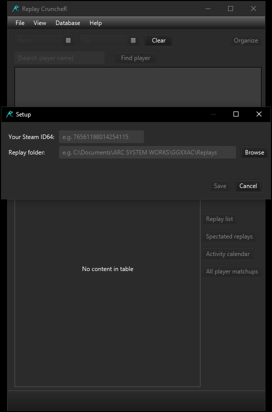

- After that, click the 'Organize' button in the upper-right corner of the window.
- The parser will start organizing your replays, this may take a couple of minutes if you have a lot of replays like me.
- A progress bar will show up like so:

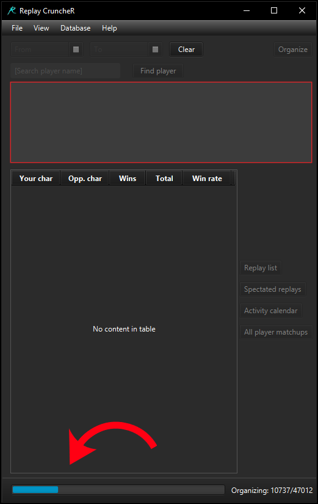

- Once the parser is done organizing, the main window will update like so:

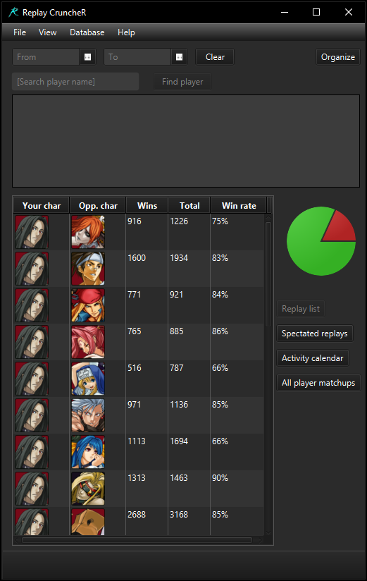

- You can use the search field in the upper section of the main window to search for specific players.
- The names fitting your query will be displayed in the box below the search field.
- The format of player names is as follows: **Current name** (known aliases, separated by -|-) [Steam64 ID]

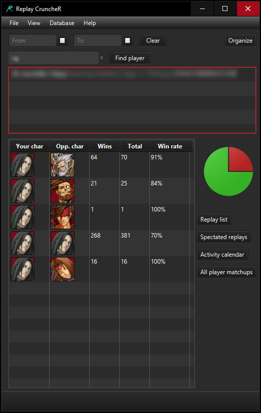

- Once you've found the player you want, you can click the 'Replay list' in the side bar.
- A new window should open, displaying all replays with the selected player.
- The 'Flag' column will show if the player disconnected or de-synced.
- In the 'Open' column, the 'Play' button will automatically open up the game and play the replay. The 'Open' button will navigate to the replay file itself.

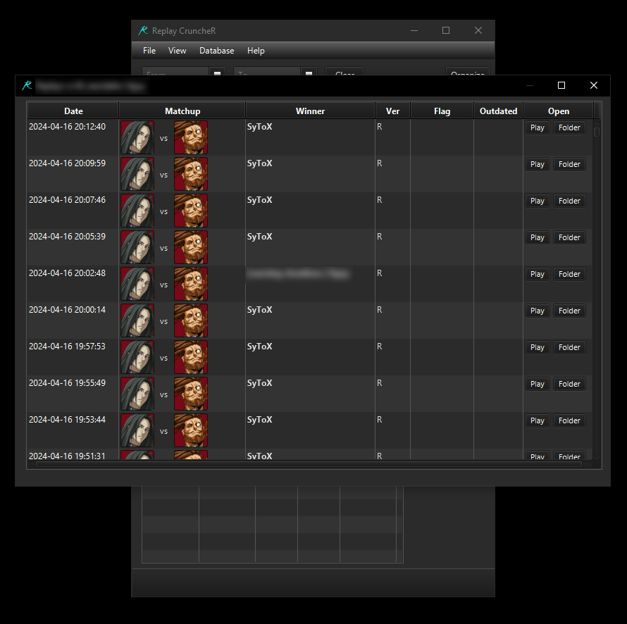

- In the 'Spectated matches', the winner of the match will be **bolded**.

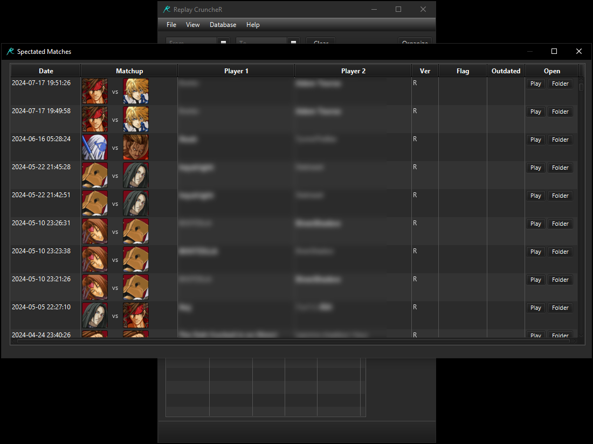

- The Activity calendar will show you which days you've played on, how many matches, and the win rate for that day.

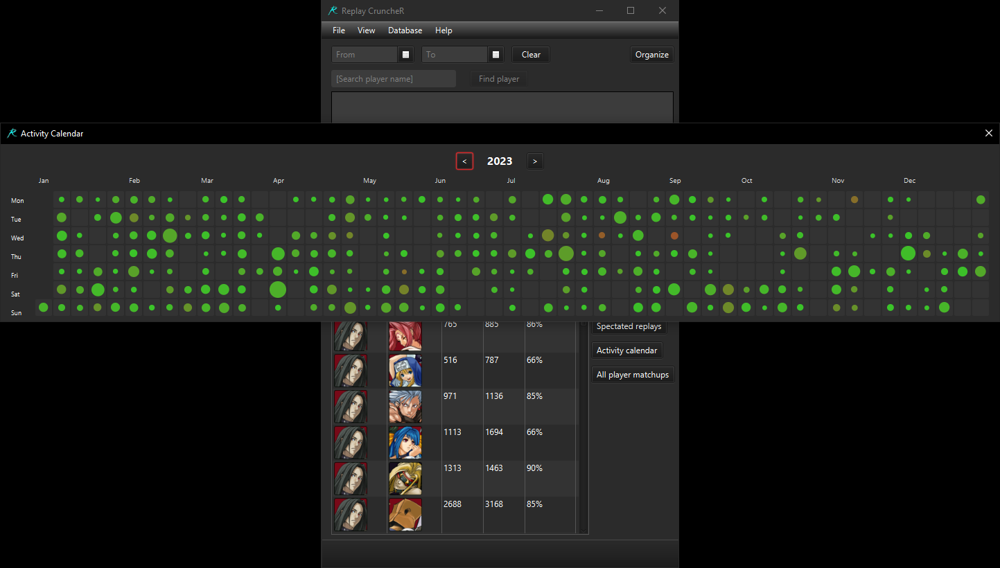

- Clicking on any of the days in the calendar will open up a list of all the replays for that day.

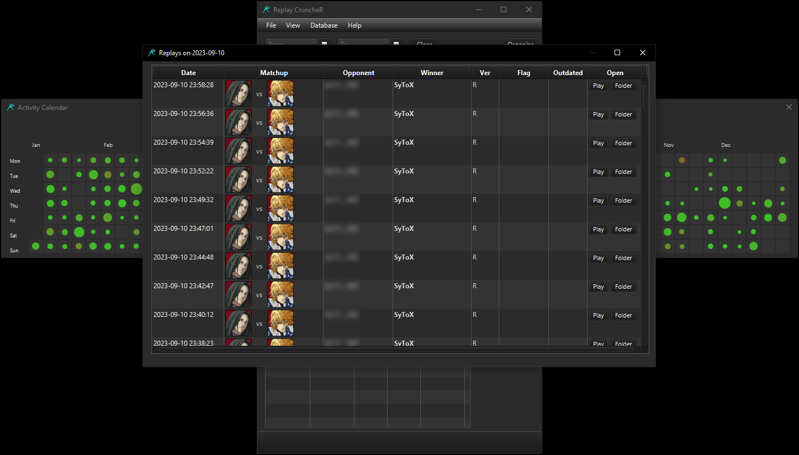

- The 'All player matchups' button will show you all the players you've played against with the selected character.
- You can change the selected character by clicking on the portrait.

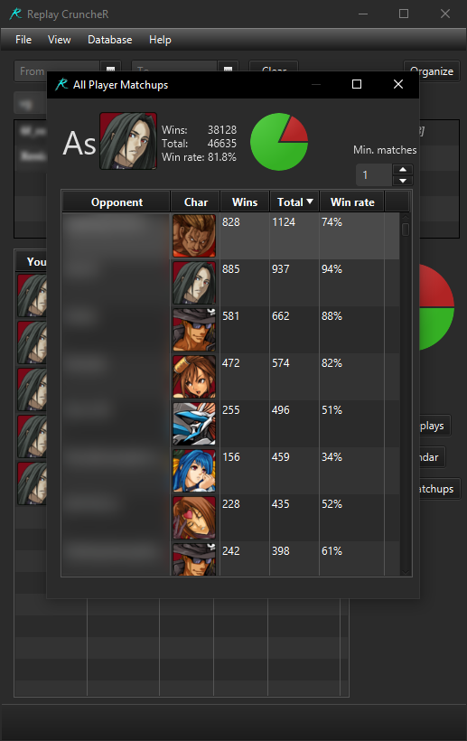

- If you don't like the parser and want to stop using it, you can restore all the replays to their original folder by clicking 'Database' -> 'Restore replays to root'

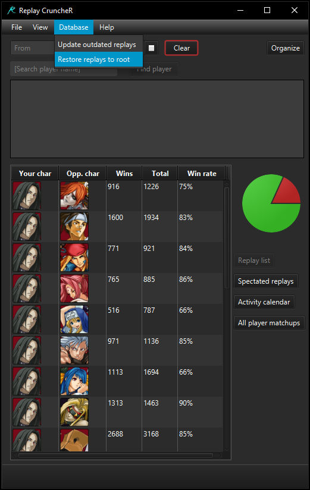

## Less important:
- You can change the theme and icon size with the 'View' menu:

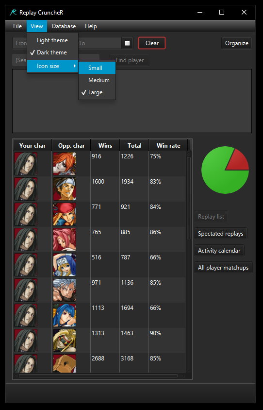

- If you happen to notice that some special characters are missing from a player's name (like uncommon emojis), this is because the parser sanitizes player names. The purpose of this is so they can be played from the UI. Also, Steam itself for some reason doesn't seem to like a lot of the strange emojis and certain kanji characters, so even if you weren't using the parser itself, you still wouldn't be able to open the replays by double-clicking on the replay file (when the .ggr file is associated with the game EXE).
- But worry not, the parser also keeps track of all the original player names before sanitizing, so if you ever decide to restore the replays to their original root folder, the original player names will be restored as well.

## Message from me:
- Thank you for reading this. I hope you enjoy using the Replay CruncheR. I know the code is bad. I've made and re-made this parser multiple times over the years, so the code a bit of a mess. This is just the final iteration.
- If you happen to find any bugs, don't hesitate to contact me.
